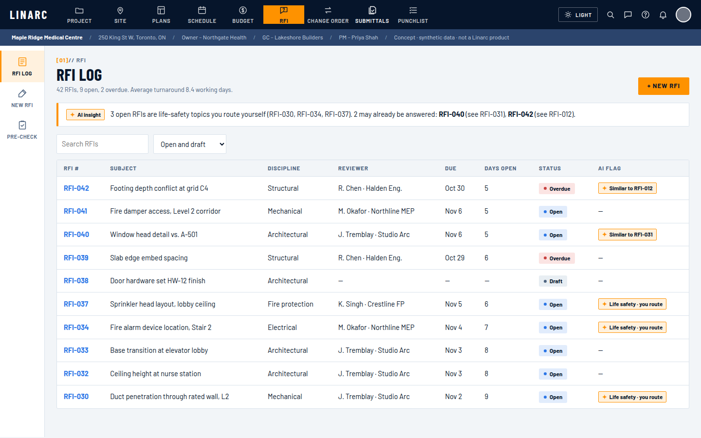
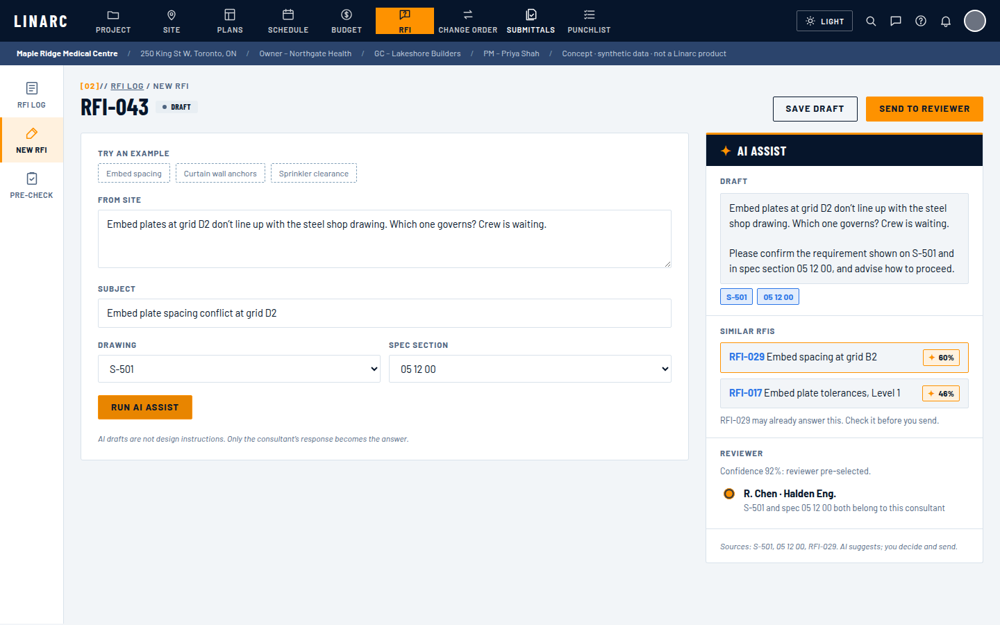
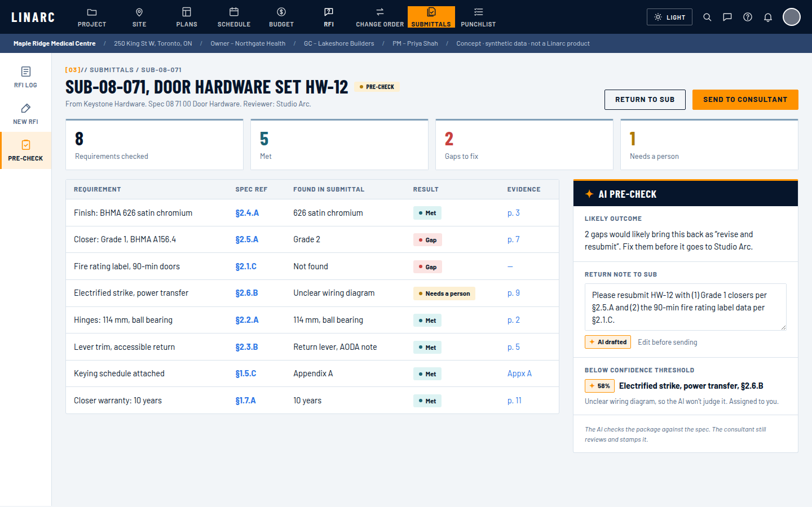
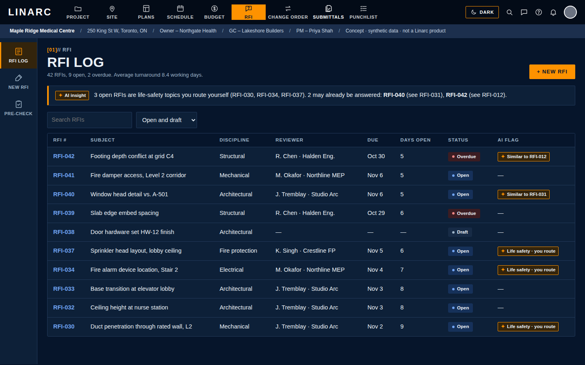

# P04 · AI RFI & Submittals Assistant

Concept AI layer for a Linarc-style construction platform, used by Canadian general contractors.
Personal portfolio project. Not a Linarc product. All project data is synthetic.

**Agents propose, a guardrail gate filters, a person approves.**



## Live demo

The clickable prototype is `index.html` at the top of this repo. Turn on GitHub Pages:
**Settings → Pages → Deploy from a branch → `main` / `/ (root)` → Save**.
Live: **https://vikram-pm.github.io/p04-rfi-assistant/**

Demo video: [`assets/demo.mp4`](assets/demo.mp4) · Interview deck: [`deliverables/P04_RFI_Assistant_Deck.pptx`](deliverables/P04_RFI_Assistant_Deck.pptx)

| New RFI + AI Assist | Submittal pre-check | Dark mode |
| --- | --- | --- |
|  |  |  |

```
orchestrator ─┬─ rfi_flow: draft_writer → duplicate_finder → reviewer_router
              └─ spec_checker
tools  → rfi_assistant/tools.py   (deterministic, scored by run_eval.py)
gate   → rfi_assistant/gate.py    (rules: life safety → manual, ≥85% one-click, 60–84% pick of two, <60% manual)
```

## Run

```bash
pip install -r requirements.txt
python run_eval.py            # scorecard against ground truth, no API key needed
streamlit run app.py          # three screens, works offline
```

Optional Gemini agents: copy `.env.example` to `.env`, add a new Google AI Studio key, then
`adk web agents` (dev UI) or toggle **Use Gemini agents** in the app.

## Files

| Path | What it is |
| --- | --- |
| `data/P04_Synthetic_Project_Data.xlsx` | 42 RFIs, 20 submittals, spec book, drawing index. Orange columns are ground truth, hidden from the agents |
| `rfi_assistant/` | Data loader, tools, guardrail gate, offline pipeline |
| `agents/rfi_agent/agent.py` | Google ADK agents (Gemini) |
| `agents/run.py` | Runs the agents, then applies the gate to the tool results |
| `run_eval.py` | Scores routing, gate, life-safety, duplicate and citation checks |
| `app.py` | Streamlit front end matching the Figma screens |
| `index.html` | Clickable prototype (GitHub Pages site) |
| `assets/` | Screenshots and demo video |
| `deliverables/` | Interview deck |

## Scorecard (synthetic set)

| Check | Result |
| --- | --- |
| Routing, historical first reviewer correct | 83% (baseline) |
| Routing, AI top suggestion correct | 100% |
| Gate split | 33 one-click · 3 pick of two · 6 manual |
| Life-safety items sent to a person | 6 of 6 |
| Duplicates caught | 2 of 3, 1 false flag |
| Citations resolved | 100% |

The synthetic data is cleaner than a real project, so treat these as a working baseline, not a forecast.
The missed duplicate (RFI-033) uses different words for the same issue; that is the case for an embedding
search in the next iteration.
